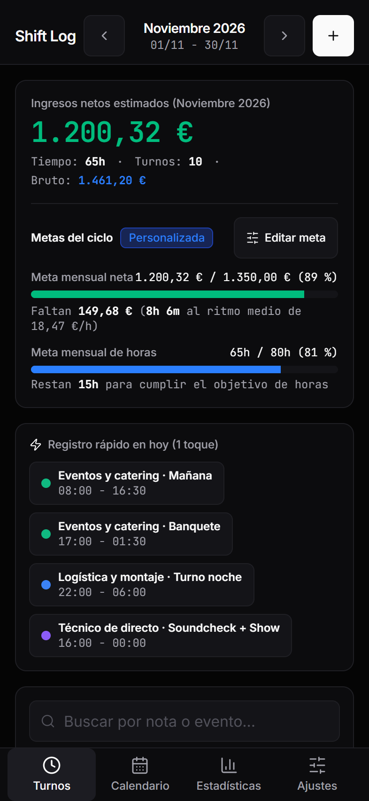
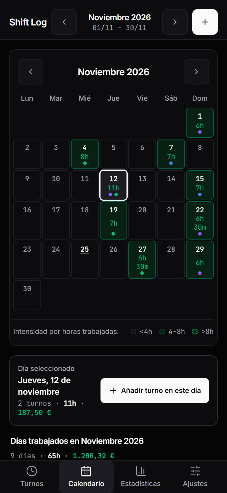
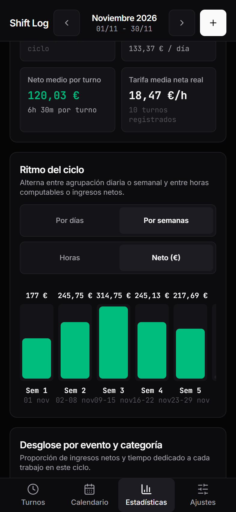
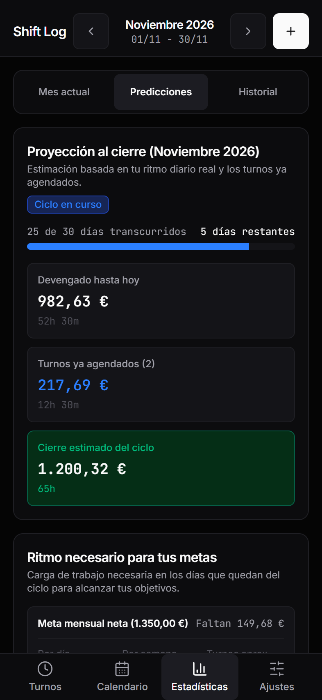

<div align="center">

# ⏱️ SHIFT LOG

**Apunta tus turnos, controla tus horas y calcula cuánto vas a cobrar cada mes**

_Aplicación web instalable (PWA) que guarda todo en tu propio móvil para registrar jornadas en segundos, personalizar metas por mes y revisar tus previsiones sin hojas de cálculo._

<p align="center">
  
  
  
  
  
  
  
  
  
</p>

</div>

---

Si trabajas por horas o combinas varios empleos y eventos (hostelería, montaje, sonido, guardias o refuerzos), sabes lo pesado que es llevar la cuenta de cada jornada. Cada sitio paga distinto, unos descuentan el descanso y otros no, hay recargos por noche o festivo y muchas veces tu mes laboral no empieza el día 1.

Apuntarlo todo en notas del móvil o en una hoja de cálculo acaba dando trabajo extra y provoca errores en cuanto cambia una tarifa. **Shift Log** nace para quitarte ese problema de encima: es una aplicación rápida, sin cuentas ni servidores externos, donde registras cada turno en segundos y ves al momento cuántas horas llevas y cuánto dinero neto esperas cobrar este mes.

---

## 📱 Vista previa de la aplicación

<p align="center">
  
  
  
  
</p>

La aplicación se divide en cuatro pestañas en la barra inferior, pensadas para usarse con una sola mano:

1. **Turnos**: muestra de un vistazo cuánto llevas acumulado este mes (neto, bruto, horas y número de turnos), tu progreso hacia las metas del ciclo con acceso directo para editarlas, los botones de registro en un toque y la lista filtrable de jornadas.
2. **Calendario**: enseña el mes completo de lunes a domingo, destacando cada día trabajado según las horas hechas y con puntos de color por trabajo. Justo debajo tienes una barra rápida para añadir un turno en el día que toques y el listado completo de todos los días trabajados del mes ordenados del más reciente al más antiguo.
3. **Estadísticas**: se ordena en tres sub-vistas limpias. En **Mes actual** ves tus días trabajados frente a libres, tus promedios reales, un gráfico alternable por días o por semanas (en horas o en euros), el peso de cada trabajo y el bloque bruto frente a neto. En **Predicciones** ves con cuánto cerrarías el mes al ritmo actual, qué ritmo necesitas para cumplir tus metas y un simulador rápido de horas o turnos extra. En **Historial** comparas la evolución de los últimos 6 ciclos.
4. **Ajustes**: organiza la configuración en tres bloques separados: **Eventos** (tus trabajos, tarifas y plantillas), **Ciclo y metas** (día de inicio de ciclo, meta base y metas distintas para cada mes) e **Informes y datos** (exportación a Excel, PDF o texto y copias de seguridad).

---

## ⚙️ Cómo funciona Shift Log

### 1. Configura cada trabajo una sola vez
En lugar de repetir tarifas y condiciones cada vez que apuntas un turno, defines cada trabajo o categoría una sola vez dentro de `Ajustes > Eventos`:

* **Tarifa neta y tarifa bruta**: indicas cuánto ganas limpio por hora (`€/h neto`) y, si quieres, el precio bruto por hora (`€/h bruto`) para conocer el descuento medio estimado.
* **Descansos, redondeos y mínimos**: puedes activar si ese trabajo descuenta pausa (por ejemplo, `30 min` por defecto), si redondea bloques a `15` o `30` minutos o si garantiza un mínimo de horas por convocatoria (por ejemplo, cobrar siempre `4 h` aunque el servicio dure menos).
* **Recargos y plantillas rápidas**: guarda tus multiplicadores habituales para **Nocturno** (`x1,25`), **Festivo** (`x1,5`) y **Hora extra** (`x1,5`), además de accesos directos como *"Mañana 08:00 - 16:30"* o *"Turno noche 22:00 - 06:00"* para fichar en un toque.
* **Archivado sin perder historial**: si dejas de trabajar en un sitio, lo archivas para que no moleste al crear nuevos turnos manteniendo intactos todos tus meses pasados.

### 2. Apunta turnos en segundos sin alterar meses anteriores
Cuando registras una jornada por horario o con una plantilla rápida, el cálculo se actualiza en vivo siguiendo un orden claro:

1. **Horario y noches**: si entras a las `22:00` y sales a las `06:00`, la aplicación detecta automáticamente el cruce de medianoche, cuenta `8 h` y guarda la jornada completa en el día en que empezaste.
2. **Pausa, redondeo y mínimo garantizado**: descuenta el descanso del día, aplica el redondeo si el evento lo usa y sube las horas al mínimo garantizado cuando corresponda. Por ejemplo, si trabajas `2 h 30 min` en un montaje que garantiza `5 h`, computará `5 h`.
3. **Recargos, pluses y gastos**: multiplica las horas por la tarifa y el tipo de jornada, y suma o resta ajustes puntuales del día como un plus de convocatoria (`+15,00 €`) o un ticket de parking (`-3,50 €`).
4. **Repetir turnos y congelar precios**: desde cualquier turno puedes clonarlo en hoy, duplicarlo en otra fecha o repetirlo en varios días del mes a la vez. Además, cada registro guarda la tarifa exacta que tenías ese día; si meses después te suben el precio por hora, tus cierres pasados nunca cambian por accidente.

### 3. Personaliza tus metas mes a mes y simula trabajo extra
No todos los meses tienen la misma carga de trabajo ni el mismo objetivo:

* **Metas propias para cada mes**: en `Ajustes > Ciclo y metas` puedes dejar una meta base por defecto (por ejemplo, `1.200 €` y `75 h`) y luego personalizar meses concretos (por ejemplo, `1.350 €` en noviembre y `1.600 €` en diciembre) o dejar un mes sin meta. También puedes editar la meta del mes actual al instante desde el botón **Editar meta** en `Turnos`.
* **Ciclo laboral a tu medida**: si tu empresa cierra el día `25` en lugar del día `1`, basta con elegir el día de arranque (`1` a `28`) para que todos los totales, metas y estadísticas se agrupen del `25` al `24` del mes siguiente.
* **Proyección de cierre y simulador rápido**: en `Estadísticas > Predicciones`, la aplicación tiene en cuenta los días que han pasado, los que faltan y los turnos que ya tengas agendados para los próximos días del mes. Desde ahí puedes ver cuántas horas o turnos necesitas para llegar a tu objetivo y usar el **Simulador rápido** para probar qué pasaría si haces `8 h` extra o `2 turnos` más con cualquiera de tus trabajos, sin modificar tus datos reales.

### 4. Exporta resúmenes y guarda copias de seguridad
Desde `Ajustes > Informes y datos` puedes sacar el resumen del mes completo o filtrado por una categoría concreta:

* **Excel (`.csv`)**: se descarga listo para abrir directamente en Microsoft Excel en español, con columnas separadas y tildes correctas.
* **PDF listo para imprimir o guardar**: genera un documento limpio con el resumen del mes (incluida tu tarifa media neta por hora), el desglose por trabajo y la tabla completa de turnos.
* **Resumen en texto (`.txt` o portapapeles)**: descárgalo o cópialo con un toque para pegarlo directamente en WhatsApp, Telegram o correo electrónico.
* **Copia de seguridad (`.json`)**: exporta toda tu información en un archivo y restáurala cuando cambies de móvil eligiendo entre **reemplazar** todo o **combinar** sin duplicar registros.

---

## 💾 Privacidad, uso sin conexión y diseño móvil

**Shift Log** funciona completamente en tu dispositivo y está pensada para resultar cómoda en el uso diario desde el móvil:

* **Sin cuentas ni servidores**: todos tus trabajos, turnos y metas se guardan al instante en el almacenamiento local del navegador. Ningún dato sale de tu teléfono salvo cuando tú exportas un informe o una copia de seguridad.
* **Instalable y lista sin cobertura (PWA)**: puedes añadirla a la pantalla de inicio en iOS o Android y abrirla sin internet en recintos, sótanos o almacenes sin señal.
* **Modo oscuro OLED y cifras alineadas**: utiliza fondos oscuros de alto contraste (`#050505` y `#0C0C0E`) para no deslumbrar en turnos nocturnos. Todos los importes, horas y porcentajes usan la fuente monoespaciada `JetBrains Mono` con alineación tabular para leer columnas de números de un vistazo.
* **Cómoda con el pulgar**: todos los botones, pestañas y celdas del calendario respetan un tamaño táctil mínimo de `44x44px`, los campos numéricos evitan el zoom involuntario en Safari iOS y la pantalla principal queda fija sin rebotes molestos al desplazarse.

---

## 🏛️ Arquitectura y estructura del proyecto

El proyecto está escrito en **TypeScript** y se organiza en tres capas separadas para mantener la lógica fácil de leer y probar:

1. **Capa de dominio puro (`src/domain/`)**: agrupa las reglas de negocio como funciones puras independientes de React, incluyendo el cálculo de turnos (`calculations.ts`), los ciclos y la resolución de metas por mes (`cycles.ts`), la analítica del mes, predicciones y simulador (`analytics.ts`), los exportadores CSV y TXT (`exporters.ts`) y la validación de copias JSON (`backup.ts`).
2. **Capa de estado y persistencia (`src/store/`)**: gestiona el estado global con **Zustand 5** (`useShiftStore.ts`), persiste los cambios en el navegador y sanea automáticamente datos antiguos al actualizar la aplicación.
3. **Capa de presentación (`src/components/`)**: construida con **React 19**, **Tailwind CSS v4** y hojas deslizables (**Vaul**), estructurada por las cuatro pestañas principales sobre los tokens semánticos de `DESIGN.md`.

```text
shiftlog/
├── DESIGN.md                                 # Sistema de diseño OLED, tokens y tipografía
├── agents.md                                 # Convenciones técnicas y flujo de trabajo SDD
├── docs/
│   ├── constitution.md                       # Principios de producto y diseño
│   ├── screenshots/                          # Capturas móviles Retina 2x de la interfaz de la app
│   └── specs/
│       ├── 01-shift-log-mvp/                 # Especificación, plan y tareas del MVP inicial
│       └── 02-goals-calendar-stats-redesign/ # Especificación, plan y tareas de la Feature 02
├── public/
│   └── icon.svg                              # Icono vectorial de la PWA
├── scripts/
│   └── generate_screenshots.mjs              # Script de capturas automatizadas con Puppeteer
├── src/
│   ├── components/
│   │   ├── calendar/                         # Cuadrícula mensual, barra del día y agenda descendente
│   │   ├── layout/                           # Estructura fija (AppShell) y navegación inferior
│   │   ├── settings/                         # Sub-vistas de eventos, ciclo/metas e informes/backup
│   │   ├── shifts/                           # Resumen del ciclo, hoja de metas, plantillas y turnos
│   │   ├── stats/                            # Mes actual, gráficos, predicciones, simulador e historial
│   │   └── ui/                               # Primitivas reutilizables (BottomSheet, EmptyState, Toast)
│   ├── domain/                               # Lógica pura de negocio y suite de pruebas Vitest
│   │   ├── __tests__/                        # Tests unitarios y de integración de interfaz
│   │   ├── analytics.ts                      # Métricas del ciclo, series, predicciones y simulador
│   │   ├── backup.ts                         # Validación de copias JSON y fusión de registros
│   │   ├── calculations.ts                   # Duración, medianoche, pausas, redondeo e importes
│   │   ├── cycles.ts                         # Ventanas de ciclo laboral y metas por mes (YYYY-MM)
│   │   ├── exporters.ts                      # Generación de informes CSV (UTF-8 BOM) y TXT
│   │   ├── formatters.ts                     # Formato español de moneda, horas y fechas
│   │   └── types.ts                          # Tipos de eventos, turnos, metas y copias de seguridad
│   ├── store/
│   │   └── useShiftStore.ts                  # Store Zustand con persistencia y migración silenciosa
│   ├── App.tsx                               # Coordinador de las 4 pestañas, hojas e informe PDF
│   ├── index.css                             # Variables semánticas de DESIGN.md y reglas WebKit
│   └── main.tsx                              # Punto de entrada de React
├── package.json                              # Dependencias y scripts del proyecto
├── tsconfig.json                             # Configuración de TypeScript
└── vite.config.ts                            # Configuración de Vite, Tailwind CSS v4, PWA y Vitest
```

---

## 🚀 Instalación y puesta en marcha

### Requisitos previos
* **Node.js**: versión `20.0.0` o superior.
* **npm**: versión `10.0.0` o superior.

### Pasos rápidos

```bash
# 1. Clonar el repositorio
git clone https://github.com/usuario/shiftlog.git
cd shiftlog

# 2. Instalar las dependencias
npm install

# 3. Arrancar el entorno de desarrollo en http://localhost:5173
npm run dev

# 4. Compilar para producción (incluye Service Worker para modo sin conexión)
npm run build

# 5. Ejecutar todas las pruebas automatizadas
npm run test:run
```

### Scripts disponibles

| Comando | Descripción |
|---|---|
| `npm run dev` | Levanta el servidor local de desarrollo con recarga instantánea en `http://localhost:5173`. |
| `npm run build` | Comprueba los tipos de TypeScript y genera la versión lista para producción en `dist/`. |
| `npm run preview` | Sirve localmente la compilación de producción para probar la instalación PWA y el modo offline. |
| `npm run test` | Ejecuta toda la suite de pruebas unitarias y de interfaz con Vitest. |
| `npm run test:watch` | Mantiene Vitest abierto en modo continuo mientras haces cambios en el código. |
| `npm run screenshots` | Ejecuta el script con Puppeteer para regenerar las capturas móviles Retina 2x de `docs/screenshots/`. |

---

## 📄 Licencia

Este proyecto se distribuye bajo la Licencia **MIT**.
