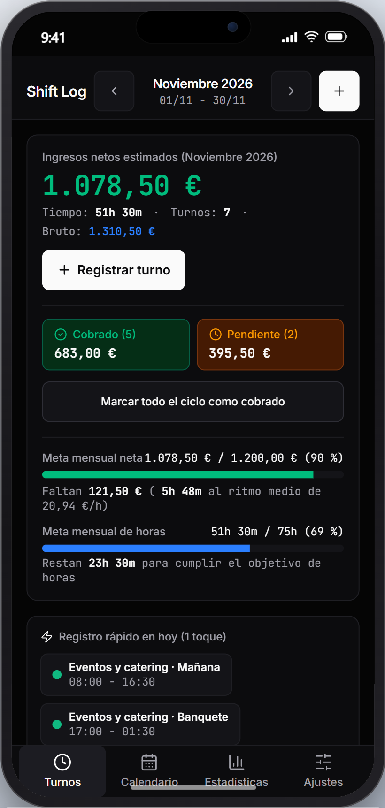
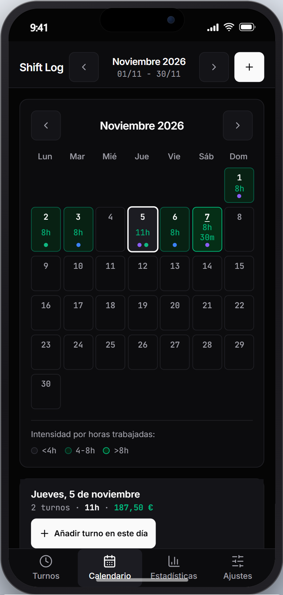
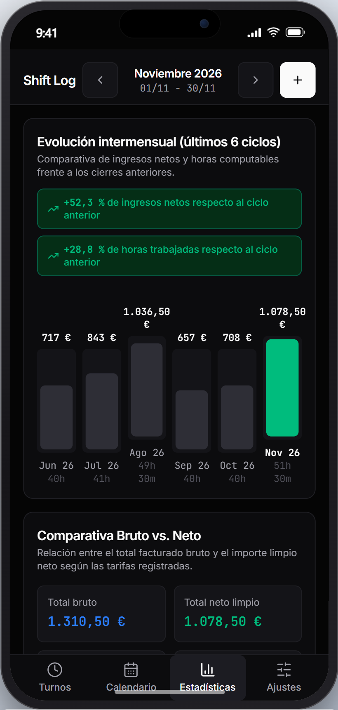
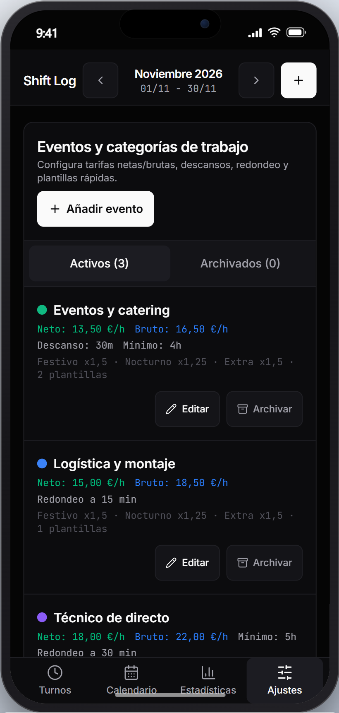

<div align="center">

# ⏱️ SHIFT LOG

**Control de turnos, facturación por ciclos e ingresos netos para profesionales por horas**

_Aplicación web instalable (PWA) 100 % local, diseñada para registrar jornadas en segundos, proteger el historial ante cambios de tarifa y exportar cierres mensuales sin depender de hojas de cálculo._

<p align="center">
  
  
  
  
  
  
  
  
  
</p>

</div>

---

Quienes trabajan por turnos o en eventos temporales (hostelería, logística, sonido y directo, guardias o refuerzos por horas) suelen combinar varias empresas o categorías de trabajo a la vez. Cada una tiene sus propias reglas: tarifas distintas, descansos que a veces se descuentan y a veces no, recargos por nocturnidad o festivo, mínimos de horas garantizadas por convocatoria y cierres de facturación que rara vez coinciden con el día 1 del mes.

Llevar este control en notas sueltas del móvil o en hojas de cálculo manuales termina provocando errores de cálculo, especialmente cuando una tarifa sube de un mes a otro o cuando hay que reclamar turnos pendientes de cobro. **Shift Log** resuelve este problema desde una aplicación rápida, privada y sin cuentas ni servidores externos, permitiendo apuntar cada jornada con una sola mano y saber al instante cuánto dinero neto llevas ganado en el ciclo actual.

---

## 📱 Vista previa de la aplicación

<p align="center">
  
  
  
  
</p>

La interfaz se organiza en cuatro vistas accesibles desde la barra inferior para facilitar el uso con el pulgar:

1. **Turnos**: Muestra el resumen financiero del ciclo en curso (importe neto acumulado, desglose entre lo ya cobrado y lo pendiente, y progreso hacia tu meta mensual), seguido de los botones de registro rápido en un toque y el listado filtrable de jornadas.
2. **Calendario**: Presenta una cuadrícula mensual (de lunes a domingo) donde cada día trabajado se ilumina según la intensidad de horas realizadas (`<4h`, `4-8h` o `>8h`) e incluye puntos de color por cada categoría trabajada ese día. Al tocar cualquier fecha se despliega el resumen diario y la opción de añadir un turno directamente en ese día.
3. **Estadísticas**: Reúne la evolución de los últimos 6 ciclos laborales con la variación porcentual respecto al cierre anterior, la comparativa entre total bruto facturado y neto limpio (con el porcentaje medio de retención), el peso de cada categoría sobre tus ingresos y el panel de exportación de informes.
4. **Ajustes**: Permite crear, editar o archivar eventos y categorías de trabajo, elegir qué día del mes arranca tu ciclo de facturación, definir tus objetivos mensuales y gestionar las copias de seguridad de tus datos.

---

## ⚙️ Cómo funciona Shift Log

### 1. Configuración a medida de cada trabajo o evento
En lugar de obligarte a introducir tarifas y descuentos cada vez que fichas un día, en **Shift Log** defines tus condiciones una sola vez dentro de cada categoría o evento:
* **Tarifas neta y bruta**: Indicas cuánto cobras limpio por hora (`€/h neto`, utilizado para todos los cálculos principales) y, opcionalmente, tu tarifa bruta (`€/h bruto`) para que las estadísticas calculen automáticamente cuánto se va en retenciones.
* **Reglas de tiempo y mínimos**: Puedes activar si ese trabajo descuenta descanso no remunerado (por ejemplo, precargar `30 min` de pausa por defecto), si aplica redondeo de bloques (`15 min` o `30 min`) o si cuenta con un mínimo de horas garantizadas por convocatoria (por ejemplo, cobrar un mínimo de `4 h` aunque el evento dure menos).
* **Recargos y plantillas de un toque**: Cada evento guarda sus propios multiplicadores para turnos de **Nocturnidad** (por defecto `x1,25`), **Festivos** (`x1,5`) y **Horas extra** (`x1,5`), además de plantillas horarias habituales (como *"Mañana 08:00 - 16:30"* o *"Banquete 17:00 - 01:30"*) para registrar la jornada con una sola pulsación.
* **Archivado limpio**: Cuando terminas una campaña o dejas de trabajar para un cliente, puedes archivar el evento. Dejará de estorbar en los selectores diarios, pero todos sus turnos e importes pasados permanecerán intactos en el historial.

### 2. Registro ágil y cálculo automático de la jornada
Al registrar un turno, ya sea desde una plantilla rápida o abriendo el formulario deslizable, la aplicación calcula el importe en vivo siguiendo siempre el mismo orden lógico:

1. **Horario y cruce de medianoche**: Introduces la hora de entrada y la de salida. Si trabajas de noche y sales al día siguiente (por ejemplo, de `22:00` a `06:00`), la aplicación detecta automáticamente el cruce de medianoche, calcula las `8 h` de duración y asigna el turno íntegro al día en que empezaste a trabajar.
2. **Descuento de pausa y redondeo**: Al tiempo bruto se le resta el descanso no remunerado del día y, si el evento lo requiere, se ajusta el resultado al bloque de `15` o `30` minutos correspondiente.
3. **Mínimo garantizado por convocatoria**: Si trabajaste `2 h 30 min` en una asistencia técnica pero tu acuerdo con esa empresa garantiza un mínimo de `5 h`, el tiempo computable se eleva automáticamente a `5 h`.
4. **Multiplicadores, pluses y gastos del día**: Sobre las horas computables se aplica la tarifa del evento y el recargo del tipo de jornada (normal, nocturno, festivo o extra). Por último, puedes sumar un plus fijo de convocatoria (`+15,00 €`) o restar un gasto directo de transporte o parking (`-3,50 €`) para obtener el neto y el bruto exactos del día.

Además, cualquier turno ya registrado se puede **clonar en el día de hoy** con un toque, **duplicar** en otra fecha o **repetir en bloque** seleccionando varios días de golpe en un calendario mensual.

### 3. Protección del historial ante cambios de tarifa
Uno de los problemas más habituales en hojas de cálculo es que, al subir el precio por hora de un trabajo, se alteran por accidente las sumas de los meses anteriores.

En **Shift Log**, cada vez que guardas un turno se congela dentro de ese registro una copia exacta de las condiciones vigentes ese día (precio neto y bruto por hora, multiplicador, redondeo y mínimo garantizado). Si dentro de tres meses renegocias tu tarifa al alza y editas el evento en `Ajustes`, todos tus cierres pasados conservarán el importe exacto al que se cobraron. Si en algún momento editas un turno antiguo cuya tarifa haya cambiado, la aplicación te avisará y te permitirá elegir si quieres mantener su precio histórico original o actualizarlo a la tarifa nueva.

### 4. Ciclos de facturación flexibles, cobros y metas
No todas las empresas cierran nómina o facturación el último día del mes:
* **Día de inicio de ciclo configurable**: Puedes elegir cualquier día entre el `1` y el `28` como arranque de ciclo. Si configuras el día `25`, tanto la pantalla principal como las metas y estadísticas agruparán automáticamente los turnos realizados desde el día `25` de un mes hasta el `24` del mes siguiente.
* **Control de cobros**: Cada turno puede marcarse como `Pendiente` o `Cobrado`. Cuando te abonan un mes completo, dispones de un botón directo para marcar todos los turnos del ciclo como cobrados de una sola vez.
* **Proyección real hacia tu meta mensual**: Si fijas un objetivo mensual en euros netos (por ejemplo, `1.200 €`) o en horas, la barra de progreso no solo muestra el porcentaje completado, sino que divide los euros que te faltan entre la **tarifa media neta real** a la que estás cobrando la hora en el ciclo actual. Así sabes con exactitud cuántas horas de trabajo te restan al ritmo real de este mes.

### 5. Exportación de informes y copia de seguridad
Para enviar el resumen de horas a una empresa, a tu gestoría o guardarlo para tu control personal, puedes exportar el ciclo completo (o únicamente los turnos filtrados por un cliente o estado de cobro) en tres formatos:
* **Excel (`.csv`)**: Genera un archivo con codificación `UTF-8 con BOM`, separado por punto y coma y con formato decimal español para que al abrirlo en Microsoft Excel todas las columnas, símbolos de euro y tildes se muestren directamente en su sitio.
* **PDF listo para imprimir o guardar**: Prepara un documento limpio con las métricas del ciclo, el desglose por categoría y la tabla detallada de jornadas.
* **Resumen en texto (`.txt` y portapapeles)**: Permite descargar el cierre en texto plano o copiarlo con un toque al portapapeles para pegarlo directamente en un mensaje de WhatsApp, Telegram o correo electrónico.
* **Copia de seguridad completa (`.json`)**: Desde `Ajustes` puedes descargar toda tu base de datos en un archivo `.json`. Al restaurar una copia, el sistema valida primero que el archivo no esté dañado y te permite elegir entre **reemplazar** los datos actuales o **combinar** los registros sin duplicar turnos.

---

## 💾 Privacidad, uso sin conexión y diseño móvil

La aplicación está construida bajo un enfoque 100 % local (*local-first*), priorizando la velocidad de respuesta y la legibilidad en pantallas móviles:

* **Tus datos no salen de tu dispositivo**: Toda la información se guarda de forma instantánea en el almacenamiento local del navegador (`localStorage` bajo la clave `shiftlog-db-v1`). No requiere registro, inicio de sesión ni conexión a internet.
* **Instalable como aplicación nativa (PWA)**: Gracias al Service Worker integrado, puedes añadir **Shift Log** a la pantalla de inicio en iOS o Android y abrirla a pantalla completa incluso en recintos, sótanos o naves sin cobertura.
* **Diseño Dark Mode OLED y números tabulares**: La interfaz utiliza una paleta oscura de alto contraste (`#050505` y `#0C0C0E`) pensada para no deslumbrar en turnos nocturnos y ahorrar batería en paneles OLED. Todos los importes, horarios, duraciones y porcentajes emplean la fuente monoespaciada `JetBrains Mono` con números tabulares (`tabular-nums`) para que las cifras queden siempre alineadas verticalmente.
* **Ergonomía táctil cuidada**: El lienzo principal está anclado al viewport para evitar rebotes elásticos en Safari iOS, todos los botones e interruptores respetan un tamaño táctil mínimo de `44x44px` y los campos de texto mantienen un tamaño base de `16px` para impedir que el navegador haga zoom involuntario al escribir.

---

## 🏛️ Arquitectura y estructura del proyecto

El código fuente está escrito íntegramente en **TypeScript** y se organiza en tres capas desacopladas para mantener la simplicidad del proyecto y facilitar las pruebas automatizadas:

1. **Capa de dominio puro (`src/domain/`)**: Contiene todas las reglas de negocio implementadas como funciones puras de TypeScript, sin ninguna dependencia de React ni del navegador. Aquí residen el motor de cálculo horario y cruce de medianoche (`calculations.ts`), el generador de ventanas de ciclo laboral (`cycles.ts`), el motor de estadísticas y ritmo de metas (`analytics.ts`), los generadores de informes (`exporters.ts`) y el validador de copias de seguridad (`backup.ts`).
2. **Capa de estado y persistencia (`src/store/`)**: Gestionada mediante **Zustand 5** (`useShiftStore.ts`), conecta la interfaz con las funciones de dominio y sincroniza automáticamente cada cambio en el almacenamiento local del dispositivo.
3. **Capa de presentación (`src/components/`)**: Construida con **React 19**, **Tailwind CSS v4** y hojas inferiores deslizables (**Vaul**), dividida por las cuatro vistas principales de la aplicación y respaldada por el sistema de tokens semánticos definido en `DESIGN.md`.

```text
shiftlog/
├── DESIGN.md                         # Sistema de diseño, paleta OLED y reglas tipográficas
├── AGENTS.md                         # Convenciones del proyecto y guía de desarrollo SDD
├── docs/
│   ├── constitution.md               # Principios base del producto
│   ├── screenshots/                  # Capturas Retina 2x enmarcadas en iPhone 15 Pro
│   └── specs/
│       └── 01-shift-log-mvp/         # Especificación funcional, plan técnico y tareas
├── public/
│   └── icon.svg                      # Icono vectorial de la PWA
├── scripts/
│   └── generate_screenshots.mjs      # Script automatizado de capturas con Puppeteer
├── src/
│   ├── components/
│   │   ├── calendar/                 # Cuadrícula mensual por intensidad horaria y detalle diario
│   │   ├── layout/                   # Contenedor principal (AppShell) y navegación inferior
│   │   ├── settings/                 # Gestión de eventos, cierre de ciclo, metas y Backup JSON
│   │   ├── shifts/                   # Resumen del ciclo, plantillas de 1 toque, lista y formularios
│   │   ├── stats/                    # Gráfico de 6 ciclos, Bruto vs. Neto, exportación e informe PDF
│   │   └── ui/                       # Componentes base (BottomSheet con Vaul, EmptyState, Toast)
│   ├── domain/                       # Lógica de cálculo y reglas de negocio puras
│   │   ├── __tests__/                # Pruebas unitarias y de integración con Vitest
│   │   ├── analytics.ts              # Agregaciones del ciclo, ritmo de meta y comparativas
│   │   ├── backup.ts                 # Validación de esquema JSON y combinación de registros
│   │   ├── calculations.ts           # Cálculo de duración, medianoche, pausa, redondeo e importes
│   │   ├── cycles.ts                 # Cálculo de ciclos laborales personalizados (día 1 a 28)
│   │   ├── exporters.ts              # Exportación nativa a CSV/Excel (UTF-8 BOM) y TXT
│   │   ├── formatters.ts             # Formato regional español de moneda, horas y fechas
│   │   └── types.ts                  # Contratos de datos de eventos, turnos y configuración
│   ├── store/
│   │   └── useShiftStore.ts          # Estado global con Zustand y persistencia en localStorage
│   ├── App.tsx                       # Coordinador de las 4 vistas, modales e informe imprimible
│   ├── index.css                     # Tokens semánticos de diseño y ajustes para iOS WebKit
│   └── main.tsx                      # Punto de entrada de la aplicación
├── package.json                      # Dependencias y scripts de ejecución
├── tsconfig.json                     # Configuración de TypeScript
└── vite.config.ts                    # Configuración de Vite, Tailwind CSS v4, PWA y Vitest
```

---

## 🚀 Instalación y puesta en marcha

### Requisitos previos
* **Node.js**: Versión `20.0.0` o superior.
* **npm**: Versión `10.0.0` o superior.

### Pasos rápidos

```bash
# 1. Clonar el repositorio
git clone https://github.com/usuario/shiftlog.git
cd shiftlog

# 2. Instalar las dependencias
npm install

# 3. Iniciar el servidor de desarrollo en http://localhost:5173
npm run dev

# 4. Compilar para producción (incluye Service Worker para modo offline)
npm run build

# 5. Ejecutar las pruebas automatizadas
npm run test:run
```

### Scripts disponibles

| Comando | Descripción |
|---|---|
| `npm run dev` | Levanta el entorno de desarrollo local con recarga instantánea en `http://localhost:5173`. |
| `npm run build` | Comprueba el tipado de TypeScript y genera la versión optimizada de producción en la carpeta `dist/`. |
| `npm run preview` | Sirve localmente la versión de producción para probar la instalación PWA y el uso sin conexión. |
| `npm run test` | Ejecuta la suite completa de pruebas unitarias y de interfaz con Vitest. |
| `npm run test:watch` | Mantiene Vitest abierto en modo interactivo mientras editas el código. |
| `npm run screenshots` | Arranca el pipeline con Puppeteer y `device-frame-pro` para regenerar las capturas de `docs/screenshots/`. |

---

## 📄 Licencia

Este proyecto se distribuye bajo la Licencia **MIT**.
